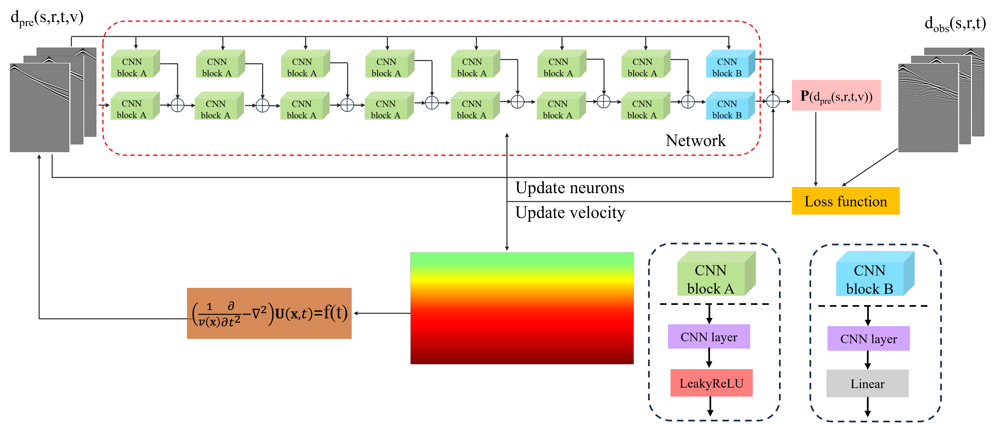
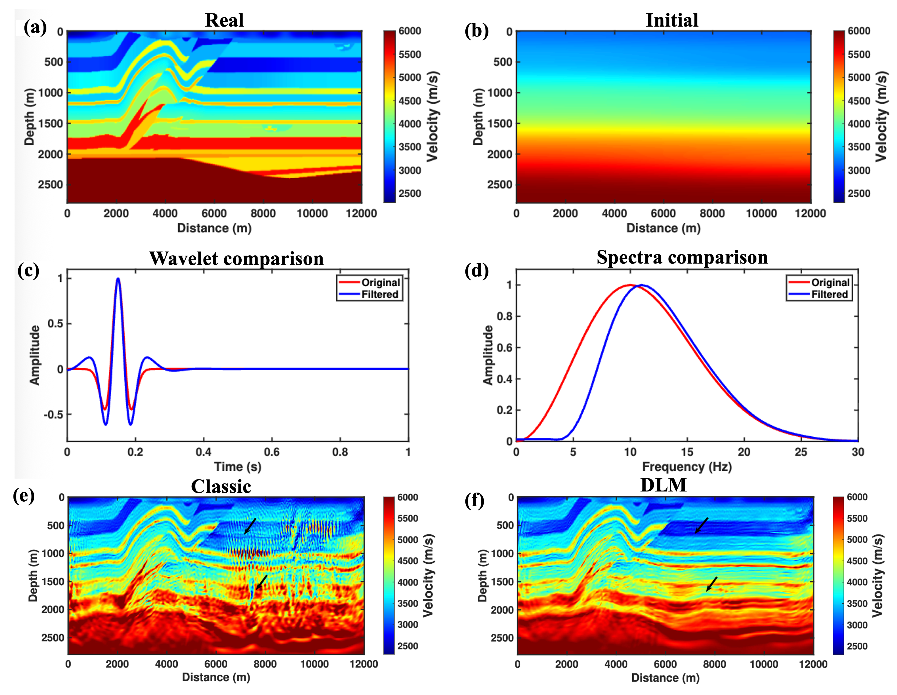

<div align="center">

# DLM-FWI: Deep learning matching filtering for full waveform inversion

**Chao Li**<sup>1</sup> &nbsp;&nbsp;
**Sergey Fomel**<sup>1</sup> &nbsp;&nbsp;
**Yangkang Chen**<sup>1</sup>

<sup>1</sup> Bureau of Economic Geology, John A. and Katherine G. Jackson School of Geosciences, The University of Texas at Austin  


</div>

---

## Overview

DLM-FWI is a deep-learning-assisted full-waveform inversion framework designed to improve inversion robustness under challenging scenarios such as cycle skipping, and inaccurate initial models.  
The method introduces a learned matching strategy to reduce the discrepancy between observed and synthetic seismic data, thereby guiding the inversion toward more reliable subsurface model updates.

---

## Abstract

Full waveform inversion (FWI) is a popular method for subsurface parameter estimation. Despite its effectiveness in building high-resolution velocity models, the quality of the inversion result is significantly dependent on a fairly accurate, smooth initial model, which is often challenging to build. To weaken the influence related to the inaccurate initial model, we propose a deep learning (DL) matching-based FWI framework, namely DLM-FWI, where multiple convolution neural networks (CNNs) are used to construct an adaptive matching filter to better pinpoint the discrepancies between the synthetic and observed data. With the help of the CNN-based matching filter, the synthetic data will be regularized first, leading to intermediate data, and the model update will be conducted by minimizing the misfit between the intermediate and the observed data for improved data-fitting. More importantly, we integrate the whole inversion process into an automatic differentiation (AD) framework, simplifying the implementation of classic FWI. We apply the proposed DLM-FWI method to both synthetic and field datasets to validate its effectiveness. The results demonstrate that compared with classic FWI, DLM-FWI performs better in subsurface model reconstruction when the initial model is far from the global minimum.

---

## Framework

<p align="center">
  
</p>

<p align="center">
  <b>Figure 1.</b> Overview of the proposed DLM-FWI framework.
</p>

The workflow of DLM-FWI consists of the following main steps:

1. Generate synthetic seismic data from the current velocity model.
2. Use a deep-learning-based matching module to generate extended synthetic data into a latent space for improved data fitting.
3. Compute the misfit between extended synthetic data and observed data.
4. Backpropagate the misfit to update the velocity model iteratively.

---

## Result

<p align="center">
  
</p>

<p align="center">
  <b>Figure 2.</b> Inversion result of Overthrust model (source components below 5 Hz are filtered).
</p>

---

## Features

- Robust against cycle skipping
- Improves inversion with poor initial models
- Compatible with conventional FWI workflows
- Free of complex adjoint source and gradient derivation and calculation.
- Easy to extend to acoustic, viscoacoustic, and elastic settings

---

## Installation

To set up the environment, run:

```bash
conda env create -f environment.yml
conda activate your_env_name
```

---

## Reference 

> Li et al., DLM-FWI: Deep-learning Matching Filtering for Full-Waveform Inversion.  

### BibTex

```bibtex
@article{li2026dlmfwi,
    author = {Li, Chao and Fomel, Sergey and Chen, Yangkang},
    title = {DLM-FWI: deep learning matching filtering for full waveform inversion},
    journal = {Geophysical Journal International},
    volume = {245},
    number = {1},
    pages = {ggag019},
    year = {2026},
    month = {01},
    doi = {10.1093/gji/ggag019},
    eprint = {https://academic.oup.com/gji/article-pdf/245/1/ggag019/66429768/ggag019.pdf}
}


```


